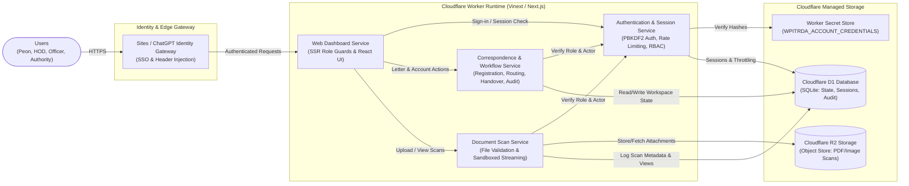

# High-Level Service Architecture — WPITRDA Mail Management System

## Core Services Summary

1. **Sites / ChatGPT Identity Gateway**: Outer edge proxy that authenticates the workspace user and injects verified identity headers (`oai-authenticated-user-*`).
2. **Web Dashboard Service**: Serves the 4 role-isolated interfaces (`/peon`, `/hod`, `/officer`, `/authority`) with server-side route protection.
3. **Authentication & Session Service**: Validates inner role credentials against **Worker Secrets** (`PBKDF2-SHA256`), enforces login rate-limiting, and manages 8-hour sessions in **D1**.
4. **Correspondence & Workflow Service**: Handles letter registration, office routing, HOD delegation, officer assignment, physical handover tracking, and append-only audit logging with optimistic locking in **D1**.
5. **Document Scan Service**: Validates file headers (`PDF`, `JPEG`, `PNG`), stores binary scans in **R2**, and streams them back with sandboxed security headers.
6. **Cloudflare D1 & R2**: Managed serverless SQLite database (`DB`) and S3-compatible object storage (`BUCKET`).
